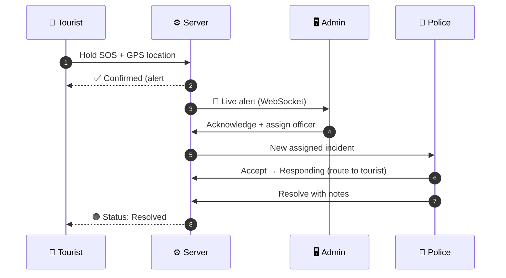
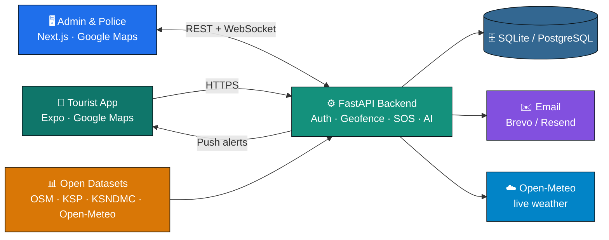

<div align="center">


<a href="#-quick-start-windows">
  
</a>

<br/>


[](https://github.com/nvaltryek-001/Tourist-Safety-monitoring-system/actions/workflows/ci.yml)
[](https://github.com/nvaltryek-001/Tourist-Safety-monitoring-system/actions/workflows/datasets.yml)
[](https://github.com/nvaltryek-001/Tourist-Safety-monitoring-system/actions/workflows/uptime.yml)


<br/>

**[✨ Features](#-features) · [🗺️ Maps](#%EF%B8%8F-google-maps--gis) · [📊 Datasets](#-real-open-datasets) · [🧠 AI](#-ai--analytics) · [🔐 Logins](#-login-details) · [💻 Run](#-quick-start-windows) · [🚀 Deploy](#-free-deployment) · [🧪 Tests](#-testing--results)**

</div>


## 📖 About

> **SafeTrail** is a **software-only** tourist safety platform. Tourists share their phone location **only after consent**, are warned when they enter **restricted or high-risk zones**, see the **nearest police stations and hospitals**, and can raise an **SOS** with one press. **Admins** and **police officers** watch everything live on a **Google Maps command centre**, get the **route to the tourist**, and resolve incidents. All analytics run on **real, documented open data**.

<table>
<tr>
<td align="center" width="20%">📍<br/><b>Real phone GPS</b><br/><sub>No wearables or IoT</sub></td>
<td align="center" width="20%">🚨<br/><b>Server-confirmed SOS</b><br/><sub>Never falsely "sent"</sub></td>
<td align="center" width="20%">🗺️<br/><b>Google Maps</b><br/><sub>Web + Android</sub></td>
<td align="center" width="20%">🏥<br/><b>7,604 facilities</b><br/><sub>Police · hospitals · fire</sub></td>
<td align="center" width="20%">🧠<br/><b>Explainable AI</b><br/><sub>Evidence for every alert</sub></td>
</tr>
</table>


## 🛠 What We Built

| ❌ Original project | ✅ SafeTrail today |
|---|---|
| 8 public API endpoints, no login | **~90 secured endpoints**, 4 roles, audit log |
| Tourist phones, emails and locations publicly readable | Role-based access, privacy masking, consent required |
| A hard-coded personal Gmail in the code | Removed; all secrets in environment variables |
| Basic SOS record | Full SOS lifecycle: timeline, assignment, duplicate protection, notes |
| No mobile app | **20+ screen** Expo Android app |
| No dashboard | **17-page** admin + police command console |
| Simple circle check | Circle + polygon geofencing, entry/exit events |
| No maps | **Google Maps** (web + Android) with OpenStreetMap fallback |
| No real data | **42 open-data sources**, cleaned, analysed, documented |
| No AI | Explainable risk scores, hotspots, route deviation, response analytics |
| No tests in CI | **98 backend tests** + dashboard & mobile checks on every push |
| No deployment | Render + Vercel + Expo EAS, backups, uptime monitoring |

> 💾 **Data safety:** the existing database is **never deleted**. Upgrades only **add** tables and columns, after an **automatic backup**.


## ✨ Features

<details open>
<summary><b>📱 Tourist Mobile App (Android, Expo)</b></summary>
<br/>

| | Feature |
|---|---|
| 🔑 | Passwordless **Gmail + 6-digit OTP** (only admin-approved Gmail addresses) |
| 🌐 | **Server connection screen**: type the PC's IP and test the connection (Expo Go friendly) |
| ✅ | **Privacy & location consent** before any sharing |
| 📡 | Real GPS, accuracy display, battery-friendly updates, optional background tracking (APK) |
| 📶 | **Offline queue** with de-duplicated batch upload and automatic retry |
| 🟢🟡🟠🔴 | Status: **Safe · Caution · Restricted · Emergency · Location unavailable** |
| 🗺️ | **Google Maps** safety map: zones, polygons, police & hospital pins, search, filters |
| 🚓 | **Nearby help**: closest police, hospital and fire station, with **Navigate** and **Call** buttons |
| 🚨 | **Hold-to-confirm SOS**, retry-safe, shows the nearest help afterwards |
| ⏱️ | Emergency tracking: Received → Acknowledged → Responding → Resolved |
| 🌦️ | **Weather alerts** (rain, storm, heat, wind) at your location |
| 🧳 | Trips, travel history, AI safety report, alerts inbox, emergency contacts, 112/100/108/1363 |

</details>

<details>
<summary><b>🖥️ Admin Dashboard (Next.js)</b></summary>
<br/>

| | Feature |
|---|---|
| 📊 | Live KPIs with animated counters |
| 🗺️ | **Live Google Map**: clustered tourists, facilities, protected areas, district risk, **SOS hotspots** |
| 🚨 | **SOS Command Centre**: New → Acknowledged → Responding → Resolved |
| 🧭 | **SOS route** from the nearest police station or hospital to the tourist (Directions API) |
| 👥 | Tourists: create, view, **edit, delete**, location history, AI risk |
| 🔑 | Gmail login access list: add, enable/disable, remove |
| 🚓 | Officers & staff: create, edit, reset password, **delete** |
| 🛡️ | **GIS zone editor**: circles, polygons, **GeoJSON / KML import & export**, overlap checks |
| 🏥 | **Emergency facilities**: full create/edit/delete + one-click OSM dataset import |
| 📊 | **Dataset management**: sources, crime chart, rainfall, district risk map, open data → zones |
| 📈 | Analytics: trends, hotspots, response times, zone activity, tourist movement |
| 📄 | **CSV reports**: incidents, zones, tourists (no contact details) |
| 🧾 | Audit log · notifications · settings · 🌗 dark / light mode |

</details>

<details>
<summary><b>🚓 Police Dashboard</b></summary>
<br/>

- Live **SOS alerts** with sound-free toast pop-ups over WebSocket
- **Assigned** incidents + **nearby unassigned** alerts sorted by distance from the officer
- **Accept → Respond → Resolve** with notes and a full timeline
- **Nearest facilities + route** and one-click **Google Maps navigation**
- **Weather at the SOS location**
- Personal **response-time stats** (median time to resolve)
- Tourist contact details shown **only during an active SOS**

</details>


## 🗺️ Google Maps & GIS

| Surface | Implementation |
|---|---|
| 🖥️ Dashboard | `@vis.gl/react-google-maps` following Google's **Maps Platform 101 React codelab**: `APIProvider`, `AdvancedMarker`, **MarkerClusterer**, circles, polygons, GeoJSON layers, info windows |
| 🧭 SOS routes | Directions API driving route, nearest police / hospital → tourist, plus a Google Maps navigation link |
| 📱 Android | `react-native-maps` with **`PROVIDER_GOOGLE`**: zones, facility pins, route line, Navigate opens the Google Maps app |
| 🔁 Fallback | No key → **OpenStreetMap** automatically, same features |
| 🛡️ Geofencing | Circle (Haversine) + polygon (point-in-polygon), entry/exit events, caution buffer |
| 📁 Formats | GeoJSON & KML import/export, polygon validation, duplicate and overlap detection |

```env
# dashboard/.env.local  (restrict the key to your website addresses)
NEXT_PUBLIC_GOOGLE_MAPS_API_KEY=your-own-key
```

🔒 Keys are **never committed**. Setup and test checklist: [`docs/GOOGLE_MAPS_SETUP.md`](docs/GOOGLE_MAPS_SETUP.md)

### 🚨 SOS Flow




## 📊 Real Open Datasets

> 📂 Everything is in [`datasets/`](datasets): `raw/` (originals, untouched) · `processed/` · `application_data/` · `analysis/` · `synthetic_test_data/` · [`dataset_manifest.csv`](datasets/dataset_manifest.csv)

| Source | Licence | What we use |
|---|---|---|
| 🗺️ **OpenStreetMap** (Overpass) | ODbL | 366 police · 3,583 hospitals · 2,334 clinics · 63 fire stations · 1,258 pharmacies · 283 attractions · 59 protected areas · 204 waterfalls & cliffs |
| 🏛️ **Karnataka State Police** (via OpenCity) | Public Domain | District crime 2022 / 2024 / 2025, road accidents |
| 🌧️ **KSNDMC** rainfall (via OpenCity) | Public Domain | Official district rainfall 2020–2025 |
| ☁️ **Open-Meteo** (ERA5) | CC BY 4.0 | 21,930 district-days of rain, heat and wind |
| 🧭 **geoBoundaries** | ODbL | 30 Karnataka district boundaries |

**🧹 Cleaning:** validated coordinates, removed **60 duplicate facilities** (mapped twice in OSM, listed in a log file), and wrote out every police unit → district mapping.
**🚫 Not faked:** NCRB, India Tourism and IMD only publish PDFs or need a data request; they are marked *Not downloaded* in the manifest.

### 🔎 Key findings

| | Finding |
|---|---|
| 📈 | Registered crimes in Karnataka: **179,389 (2022) → 201,733 (2025), +12.5 %** |
| 🔐 | 2024: **22,115 thefts** and **22,397 cyber crimes** |
| 🚓 | Median distance from a tourist attraction to the nearest police station: **2.1 km** (hospital: **1.9 km**) |
| ⚠️ | **76 attractions** are more than **15 km** from any mapped police station |
| 🌧️ | 2025: **11 districts** had rainfall ≥ 20 % above normal (Vijayapura **+47 %**) |

📄 Full report with charts: [`datasets/analysis/report.md`](datasets/analysis/report.md)


## 🧠 AI & Analytics

| Signal | How it works |
|---|---|
| 📈 Crime trends | District crime 2022 → 2025 from police data |
| 🌦️ Weather risk | Live Open-Meteo: thunderstorm, heavy rain, wind gusts, heat |
| 🔥 Hotspots | 500 m grid of real SOS & restricted-zone entries (says "not enough data" below 5 events) |
| 🧭 Route deviation | Statistical anomaly against the tourist's own path |
| 🧍 Stationary / stale | Not moving 45+ min, or no update for 30+ min |
| 🛡️ Zone activity | Entries, unique tourists, time spent inside, who is inside now |
| ⏱️ Response times | Median & slowest-10 % time to acknowledge and resolve, per officer and type |
| 🗺️ District risk index | Crime 55 % · heavy rain 30 % · heat 15 % (ranked, fully explained) |

> 💡 Every AI output is labelled **AI Advisory**, never a confirmed emergency. **No ML model is trained**, because no labelled incident data exists, and the project says so honestly.


## 🏗 Architecture




## 🔐 Login Details

<table>
<tr><th>Role</th><th>Local demo email</th><th>Opens</th></tr>
<tr><td>👑 <b>Super Admin</b></td><td><code>superadmin@demo.local</code></td><td>Everything + manage admins</td></tr>
<tr><td>🛠️ <b>Admin</b></td><td><code>admin@demo.local</code></td><td>Tourists, zones, facilities, reports</td></tr>
<tr><td>🚓 <b>Police</b></td><td><code>police@demo.local</code></td><td>Officer workspace</td></tr>
</table>

**Passwords are not published.** With `SEED_DEMO_STAFF=true` (local only) the backend creates these accounts once:

- if `DEMO_SUPERADMIN_PASSWORD` / `DEMO_ADMIN_PASSWORD` / `DEMO_POLICE_PASSWORD` are set in `backend/.env`, those are used;
- otherwise a random strong password is generated and written to **`backend/demo_credentials.txt`** (git-ignored) — open that file after the first start.

Forgot one, or your database still has an old password? Reset it safely (prompts, nothing echoed):

```bash
cd backend
python -m app.scripts.set_password admin@demo.local
```

> ⚠️ Demo accounts switch off automatically in production. On the live server, create your own admin with `BOOTSTRAP_ADMIN_EMAIL` and `BOOTSTRAP_ADMIN_PASSWORD`.

<details>
<summary><b>📱 How tourists log in</b></summary>
<br/>

1. An admin adds the tourist's **Gmail** under **Dashboard → Tourist login access**
2. The tourist types that Gmail in the app
3. A **6-digit code** arrives (valid 5 min, single use, 5 tries)
4. **No email set up?** Demo mode shows the code in a yellow box in the app (`OTP_DEV_ECHO=true`)

🔒 Gmail addresses that are not approved cannot sign in.

</details>


## 💻 Quick Start (Windows)

<details open>
<summary><b>✅ Requirements</b></summary>
<br/>

| Tool | Version |
|---|---|
| 🐍 Python | 3.11+ (tick **Add to PATH**) |
| 🟢 Node.js | 20+ LTS |
| 🔧 Git | latest |
| 📱 Expo Go | from the Play Store |

</details>

<details open>
<summary><b>1️⃣ Get the project</b></summary>

```powershell
git clone https://github.com/nvaltryek-001/Tourist-Safety-monitoring-system.git
cd Tourist-Safety-monitoring-system
```
💾 Have the existing `tourist_safety.db`? Put it in the `backend` folder **before** starting. Already cloned? Use `git pull origin main`.

</details>

<details open>
<summary><b>2️⃣ Backend: Terminal 1 (keep open)</b></summary>

```powershell
cd backend
python -m venv .venv
.venv\Scripts\activate
pip install -r requirements.txt
copy .env.example .env
uvicorn app.main:app --host 0.0.0.0 --port 8000
```
🏥 On first start it **loads the 7,604 emergency facilities** automatically.
🛠️ If `activate` is blocked: `Set-ExecutionPolicy -Scope CurrentUser RemoteSigned`

</details>

<details open>
<summary><b>3️⃣ Dashboard: Terminal 2 (keep open)</b></summary>

```powershell
cd dashboard
copy .env.example .env.local
npm install
npm run dev
```
🗺️ For Google Maps, add your key to `.env.local`. 🌐 `ECONNRESET`? Use a mobile hotspot and run `npm install` again.

</details>

<details open>
<summary><b>4️⃣ Android app: Terminal 3</b></summary>

```powershell
cd mobile
npm install
npx expo install --fix
npx expo start
```
1. Phone on the **same Wi-Fi** as the PC → open **Expo Go** → scan the QR code
2. In the app: **Server connection** → type your PC's IPv4 (from `ipconfig`) → **Test** → **Save**
3. Allow **Python / Node** through the Windows Firewall if asked

</details>

### 🌐 Local URLs

| | What | URL |
|---|---|---|
| 💚 | Health check | http://localhost:8000/health |
| 🗄️ | Database check | http://localhost:8000/ready |
| 📘 | API docs | http://localhost:8000/docs |
| 🖥️ | Dashboard | http://localhost:3000 |
| 📱 | Phone test | http://YOUR-PC-IP:8000/health |


## 🚀 Free Deployment

<details>
<summary><b>🟣 Backend + database: Render</b></summary>
<br/>

1. **render.com** → **New → Blueprint** → this repo (`render.yaml` creates the API + free PostgreSQL)
2. Fill in `BOOTSTRAP_ADMIN_EMAIL`, `BOOTSTRAP_ADMIN_PASSWORD`
3. Optional email: a free **Brevo** API key (Render's free tier blocks SMTP)
4. Check `https://your-api.onrender.com/health` ✅

</details>

<details>
<summary><b>⚫ Dashboard: Vercel</b></summary>
<br/>

1. **vercel.com** → **Add New Project** → root directory `dashboard`
2. Env: `NEXT_PUBLIC_API_URL` and `NEXT_PUBLIC_GOOGLE_MAPS_API_KEY`
3. On Render set `ALLOWED_ORIGINS = https://your-project.vercel.app`

</details>

<details>
<summary><b>🤖 Android APK: Expo EAS</b></summary>

```powershell
cd mobile
npm install -g eas-cli
eas login
eas init
eas secret:create --name GOOGLE_MAPS_ANDROID_API_KEY --value <your-android-key>
eas build -p android --profile preview
```

</details>

<details>
<summary><b>💓 Monitoring & backups</b></summary>
<br/>

- `/health`, `/ready`, `/api/v1/system/metrics` (admin)
- **Uptime** workflow pings the API every 30 min: set the repo variable `SAFETRAIL_API_URL`
- Backups: `python -m app.scripts.backup_db` (SQLite copy or `pg_dump`)
- Copy local data to the cloud: `python -m app.scripts.copy_sqlite_to_postgres`

</details>


## 🧪 Testing & Results

| Suite | Status |
|---|---|
| 🐍 Backend (pytest) | [](https://github.com/nvaltryek-001/Tourist-Safety-monitoring-system/actions/workflows/ci.yml) live — see [docs/FINAL_RELEASE_AUDIT.md](docs/FINAL_RELEASE_AUDIT.md) |
| 🖥️ Dashboard lint · types · tests · build | same CI workflow (job *dashboard*) |
| 📱 Mobile types · tests | same CI workflow (job *mobile*, incl. `expo install --check`) |
| 📊 Dataset pipeline |  |
| ⚡ Speed (in-process) |  |

✔️ Includes a test against the **real OSM dataset** (a police station within 3 km of MG Road, Bengaluru) and the full **tourist → SOS → admin → police → resolved** flow.

<details>
<summary><b>✅ Full CRUD coverage</b></summary>
<br/>

| Resource | Create | Read | Update | Delete |
|---|:-:|:-:|:-:|:-:|
| 👥 Tourists | ✅ | ✅ | ✅ | ✅ |
| 🔑 Gmail login access | ✅ | ✅ | ✅ | ✅ |
| 🚓 Officers & staff | ✅ | ✅ | ✅ | ✅ |
| 🛡️ Safety zones (+ GeoJSON/KML) | ✅ | ✅ | ✅ | ✅ |
| 🏥 Emergency facilities | ✅ | ✅ | ✅ | ✅ |
| 🚨 SOS incidents | ✅ | ✅ | ✅ | kept for audit |

</details>


## 🔒 Security & Privacy

<table>
<tr><td>✅ Consent before sharing</td><td>🔐 PBKDF2 password hashing</td><td>⛔ Lock after 5 failed logins</td></tr>
<tr><td>🚪 Real logout & device sign-out</td><td>🚦 Rate limits on OTP, login, SOS</td><td>🕵️ Police see contacts only during SOS</td></tr>
<tr><td>🧾 Full audit log (incl. report exports)</td><td>🗑️ 30-day location retention</td><td>🔑 No secrets or databases on GitHub</td></tr>
</table>


## 📂 Project Structure

```
📦 Tourist-Safety-monitoring-system
 ┣ 🐍 backend/        FastAPI API · services · migrations · scripts · tests
 ┣ 🖥️ dashboard/      Next.js admin + police dashboard (Google Maps)
 ┣ 📱 mobile/         Expo Android tourist app (Google Maps)
 ┣ 📊 datasets/       raw · processed · application_data · analysis · manifest
 ┣ 📚 docs/           Documentation & reports
 ┣ ⚙️ .github/        CI · dataset pipeline · uptime check
 ┣ ☁️ render.yaml     Free Render deployment
 ┣ 🐳 docker-compose.yml
 ┗ 📄 README.md
```

<details>
<summary><b>📚 Documentation (18 files)</b></summary>
<br/>

| | Topic | File |
|---|---|---|
| 🧭 | Overview | `docs/PROJECT_OVERVIEW.md` |
| 🏗️ | Architecture | `docs/SYSTEM_ARCHITECTURE.md` |
| 🗄️ | Database | `docs/DATABASE_DESIGN.md` |
| 🔌 | API | `docs/API_DOCUMENTATION.md` |
| 🔐 | Authentication | `docs/AUTHENTICATION.md` |
| 📍 | GPS & location | `docs/GPS_AND_LOCATION.md` |
| 🛡️ | Geofencing | `docs/GEOFENCING.md` |
| 🗺️ | Google Maps setup | `docs/GOOGLE_MAPS_SETUP.md` |
| 🗂️ | Datasets | `docs/DATASET_DOCUMENTATION.md` · `datasets/README.md` |
| 📊 | Dataset analysis | `datasets/analysis/report.md` |
| 🚨 | SOS workflow | `docs/SOS_WORKFLOW.md` |
| 🧠 | AI intelligence | `docs/AI_INTELLIGENCE.md` |
| 🔒 | Security audit | `docs/SECURITY_AUDIT.md` |
| 🧪 | Testing report | `docs/TESTING_REPORT.md` |
| 🚀 | Deployment | `docs/DEPLOYMENT_GUIDE.md` |
| ⚙️ | Environment variables | `docs/ENVIRONMENT_VARIABLES.md` |
| ⚠️ | Limitations | `docs/KNOWN_LIMITATIONS.md` |
| 🏁 | Final report | `docs/FINAL_COMPLETION_REPORT.md` |

</details>

<details>
<summary><b>⚠️ Honest limitations (~91 % complete)</b></summary>
<br/>

- 🗺️ Google Maps rendering needs **your own API key** to see it live
- 📱 GPS, background tracking and push need testing on a **real phone / APK**
- 🗄️ The real tourist database is private and not on GitHub
- 🧪 209 zones = 200 synthetic test zones + 9 college demo zones (200 m; 50 m not applied)
- 📄 NCRB / tourism statistics exist only as PDFs, so they were not downloaded
- 🧠 No ML model trained, because there is no labelled incident data
- 💬 SMS alerts not implemented · PostGIS not required at this data size

</details>


## 👥 Team

<table>
<tr>
<td align="center"><b>Your Name</b><br/><sub>Role</sub></td>
<td align="center"><b>Team Member</b><br/><sub>Role</sub></td>
<td align="center"><b>Team Member</b><br/><sub>Role</sub></td>
<td align="center"><b>Team Member</b><br/><sub>Role</sub></td>
</tr>
</table>

<div align="center">

**🎓 Guide:** _Guide Name_ &nbsp;·&nbsp; **🏫 College:** _College Name_ &nbsp;·&nbsp; **📅 Year:** 2026

<br/>

**Data credits:** © OpenStreetMap contributors · Karnataka State Police & KSNDMC via OpenCity · Open-Meteo.com · geoBoundaries

⭐ **If you like this project, give it a star!** ⭐


</div>
