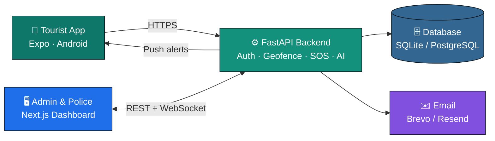
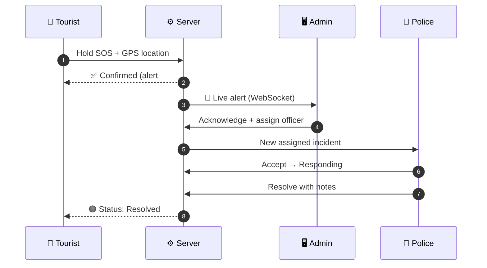

<div align="center">


<a href="#-quick-start-windows">
  
</a>

<br/>


-46E3B7?style=flat-square&logo=render&logoColor=black)

<br/>

**[✨ Features](#-features) · [🏗 Architecture](#-architecture) · [🔐 Logins](#-login-details) · [💻 Quick start](#-quick-start-windows) · [🚀 Deploy](#-free-deployment) · [🧪 Tests](#-testing--results) · [📚 Docs](#-documentation)**

</div>


## 📖 About

> **SafeTrail** is a **software-only** tourist safety platform. Tourists share their phone location **only after consent**, are warned when they enter **restricted or high-risk zones**, and can raise an **SOS** with one press. **Admins** and **police officers** monitor everything live on a web command centre and respond to emergencies.

<table>
<tr>
<td align="center" width="25%">📍<br/><b>Real phone GPS</b><br/><sub>No wearables or IoT</sub></td>
<td align="center" width="25%">🚨<br/><b>Server-confirmed SOS</b><br/><sub>Never falsely "sent"</sub></td>
<td align="center" width="25%">🛡️<br/><b>Geofencing</b><br/><sub>Circles and polygons</sub></td>
<td align="center" width="25%">🧠<br/><b>Explainable AI</b><br/><sub>Advisories with evidence</sub></td>
</tr>
</table>


## ✨ Features

<details open>
<summary><b>📱 Tourist Mobile App (Android, Expo)</b></summary>
<br/>

| | Feature |
|---|---|
| 🔑 | Passwordless **Gmail + 6-digit OTP** login |
| ✅ | **Privacy & location consent** before any sharing |
| 📡 | Real GPS with accuracy display, battery-friendly updates |
| 📶 | **Offline queue**: locations saved and uploaded later |
| 🟢🟡🟠🔴 | Status: **Safe · Caution · Restricted · Emergency · Location unavailable** |
| 🗺️ | Safety map with zones, search, filters and legend |
| 🚨 | **Hold-to-confirm SOS**, safe to retry with no duplicates |
| ⏱️ | Emergency tracking: Received → Acknowledged → Responding → Resolved |
| 🔔 | Alerts, trips, travel history, AI safety report |
| ☎️ | Emergency contacts + helplines **112 · 100 · 108 · 1363** |

</details>

<details>
<summary><b>🖥️ Admin Dashboard (Next.js)</b></summary>
<br/>

| | Feature |
|---|---|
| 📊 | Live KPIs from the real database |
| 🗺️ | **Live map** over WebSocket with clustering and stale markers |
| 🚨 | **SOS Command Centre**: New → Acknowledged → Responding → Resolved |
| 👥 | Tourist management, search, filters, location history |
| 🧭 | Zone editor + **GeoJSON / KML import & export** |
| 🧾 | Dataset audit: counts, duplicates, overlaps |
| 🔐 | Tourist Gmail access list, officer accounts, **audit log** |
| 🧠 | AI intelligence + analytics charts |
| 🌗 | Light and dark mode, responsive on desktop and tablet |

</details>

<details>
<summary><b>🚓 Police Dashboard</b></summary>
<br/>

- Officer workspace: **assigned** incidents + **nearby unassigned** SOS (sorted by distance)
- **Accept → Respond → Resolve** with notes and a full timeline
- One-click **Google Maps navigation** to the tourist
- Contact details visible **only during an active SOS**
- No access to admin settings, zones, staff or audit logs

</details>

<details>
<summary><b>🧠 AI Safety Intelligence</b></summary>
<br/>

| Signal | How it works |
|---|---|
| 🧍 Prolonged stationary | Stayed within 50 m for 45+ minutes |
| 🧭 Route deviation | Statistical anomaly (median / MAD z-score) against the tourist's own path |
| ⛔ High-risk entry | Entered a restricted / high-risk zone |
| 🔁 Repeated entry | 2+ restricted entries in 24 hours |
| 📉 Stale location | No update for 30+ minutes |
| 📈 Risk score | 0–100 → Low / Medium / High / Critical, with reasons |

> 💡 Every output is labelled **AI Advisory**, never a confirmed emergency. No ML model is trained because there isn't enough real data. The system is honest about this.

</details>


## 🏗 Architecture



### 🚨 SOS Flow




## 🛠 What We Built

| ❌ Before | ✅ After |
|---|---|
| 8 public API endpoints | ~75 secured endpoints with roles |
| No login | Gmail OTP (tourists) + passwords (staff) |
| Tourist data publicly visible | Role-based access + privacy masking |
| Basic SOS record | Full SOS lifecycle, timeline, no duplicates |
| No mobile app | **20-screen** Android app |
| No dashboard | **15-page** admin + police dashboard |
| No live updates | WebSocket real-time map and alerts |
| No AI | Explainable safety intelligence |
| No CI | GitHub Actions: **82 backend tests passing** |
| No deployment | Free hosting on **Render + Vercel** |

> 💾 **Data safety:** the existing database is **never deleted**. Upgrades only **add** tables and columns, after an **automatic backup**.


## 🔐 Login Details

<table>
<tr><th>Role</th><th>Email</th><th>Password</th><th>Opens</th></tr>
<tr><td>👑 <b>Super Admin</b></td><td><code>superadmin@demo.local</code></td><td><code>SuperAdmin@123</code></td><td>Overview + manage admins</td></tr>
<tr><td>🛠️ <b>Admin</b></td><td><code>admin@demo.local</code></td><td><code>Admin@12345</code></td><td>Overview, tourists, zones</td></tr>
<tr><td>🚓 <b>Police</b></td><td><code>police@demo.local</code></td><td><code>Police@12345</code></td><td>Officer workspace</td></tr>
</table>

> ⚠️ Demo accounts work **only locally** and are switched off automatically in production. On the live server, create your own admin with `BOOTSTRAP_ADMIN_EMAIL` and `BOOTSTRAP_ADMIN_PASSWORD`.

<details>
<summary><b>📱 How tourists log in</b></summary>
<br/>

1. An admin links the tourist to their **Gmail** under **Tourist Login Access**
2. The tourist types that Gmail in the app
3. A **6-digit code** arrives (valid 5 min, single use, 5 tries)
4. **No email set up?** Demo mode shows the code in a yellow box in the app

🔒 Only approved Gmail addresses can sign in.

</details>


## 💻 Quick Start (Windows)

<details open>
<summary><b>✅ Requirements</b></summary>
<br/>

| Tool | Version | Get it |
|---|---|---|
| 🐍 Python | 3.11+ (tick **Add to PATH**) | python.org |
| 🟢 Node.js | 20+ LTS | nodejs.org |
| 🔧 Git | latest | git-scm.com |
| 📱 Expo Go | latest | Play Store |

</details>

<details open>
<summary><b>1️⃣ Download the project</b></summary>

```powershell
cd C:\Users\<your-name>
git clone https://github.com/nvaltryek-001/Tourist-Safety-monitoring-system.git
cd Tourist-Safety-monitoring-system
```
💾 Have the existing `tourist_safety.db`? Copy it into the `backend` folder **before** starting.

</details>

<details open>
<summary><b>2️⃣ Backend: Terminal 1 (keep open)</b></summary>

```powershell
cd backend
python -m venv .venv
.venv\Scripts\activate
pip install -r requirements.txt
copy .env.example .env
uvicorn app.main:app --host 0.0.0.0 --port 8000 --reload
```
🛠️ If `activate` is blocked, run `Set-ExecutionPolicy -Scope CurrentUser RemoteSigned` once.

</details>

<details open>
<summary><b>3️⃣ Dashboard: Terminal 2 (keep open)</b></summary>

```powershell
cd dashboard
copy .env.example .env.local
npm install
npm run dev
```
🌐 `ECONNRESET` error? Switch to a mobile hotspot and run `npm install` again.

</details>

<details open>
<summary><b>4️⃣ Android app: Terminal 3</b></summary>

```powershell
ipconfig
cd mobile
copy .env.example .env
npm install
npx expo install --fix
npx expo start
```
1. Note your Wi-Fi **IPv4** from `ipconfig` (e.g. `192.168.1.10`)
2. In `mobile\.env` set `EXPO_PUBLIC_API_URL=http://192.168.1.10:8000`, using your IP
3. Put the phone on the **same Wi-Fi**
4. Open **Expo Go** and scan the QR code
5. Allow **Python / Node** through the Windows Firewall if asked

</details>

### 🌐 Local URLs

| | What | URL |
|---|---|---|
| 💚 | Health check | http://localhost:8000/health |
| 🗄️ | Database check | http://localhost:8000/ready |
| 📘 | API docs (Swagger) | http://localhost:8000/docs |
| 🖥️ | Dashboard | http://localhost:3000 |
| 📱 | Phone test | http://YOUR-PC-IP:8000/health |


## 🚀 Free Deployment

<details>
<summary><b>🟣 Step 1: Backend + database on Render</b></summary>
<br/>

1. **render.com** → sign in with GitHub → **New → Blueprint** → this repo
2. `render.yaml` creates the API + a **free PostgreSQL** database
3. Fill in `BOOTSTRAP_ADMIN_EMAIL` and `BOOTSTRAP_ADMIN_PASSWORD`
4. Optional email: free **Brevo** API key → `EMAIL_API_KEY`, verified sender → `EMAIL_FROM`
5. Check: `https://your-api.onrender.com/health` ✅

> ℹ️ Render's free tier blocks SMTP, so this project uses the **Brevo** email API.

</details>

<details>
<summary><b>⚫ Step 2: Dashboard on Vercel</b></summary>
<br/>

1. **vercel.com** → **Add New Project** → this repo
2. Root directory: `dashboard`
3. Env: `NEXT_PUBLIC_API_URL = https://your-api.onrender.com`
4. **Deploy** 🎉
5. On Render, set `ALLOWED_ORIGINS = https://your-project.vercel.app`

</details>

<details>
<summary><b>🤖 Step 3: Android APK with Expo EAS</b></summary>

```powershell
cd mobile
npm install -g eas-cli
eas login
eas init
eas build -p android --profile preview
```
Set your Render URL in `eas.json` before building. Push notifications work in the APK.

</details>


## 🧪 Testing & Results

| Suite | Status |
|---|---|
| 🐍 Backend (pytest) |  |
| 🖥️ Dashboard lint · types · tests · build |  |
| 📱 Mobile types · tests |  |
| ⚡ Performance smoke |  |

<details>
<summary><b>▶️ Run tests yourself</b></summary>

```powershell
# Backend
cd backend
pip install -r requirements-dev.txt
pytest -q

# Dashboard
cd dashboard
npm run lint
npm run typecheck
npm test
npm run build

# Mobile
cd mobile
npm run typecheck
npm test
```

</details>


## 🔒 Security & Privacy

<table>
<tr>
<td>✅ Consent before sharing</td>
<td>🔐 PBKDF2 password hashing</td>
<td>⛔ Lock after 5 failed logins</td>
</tr>
<tr>
<td>🚪 Real logout & device sign-out</td>
<td>🚦 Rate limits on OTP, login, SOS</td>
<td>🕵️ Police see contacts only during SOS</td>
</tr>
<tr>
<td>🧾 Full audit log</td>
<td>🗑️ 30-day location retention</td>
<td>🔑 No secrets in code</td>
</tr>
</table>


## 📂 Project Structure

```
📦 Tourist-Safety-monitoring-system
 ┣ 🐍 backend/        FastAPI API · services · migrations · tests
 ┣ 🖥️ dashboard/      Next.js admin + police dashboard
 ┣ 📱 mobile/         Expo Android tourist app
 ┣ 📚 docs/           Full documentation & reports
 ┣ ☁️ render.yaml     Free Render deployment
 ┣ 🐳 docker-compose.yml
 ┗ 📄 README.md
```

## 📚 Documentation

<details>
<summary><b>Open all 16 documents</b></summary>
<br/>

| | Topic | File |
|---|---|---|
| 🧭 | Overview | `docs/PROJECT_OVERVIEW.md` |
| 🏗️ | Architecture | `docs/SYSTEM_ARCHITECTURE.md` |
| 🗄️ | Database | `docs/DATABASE_DESIGN.md` |
| 🔌 | API | `docs/API_DOCUMENTATION.md` |
| 🔐 | Authentication | `docs/AUTHENTICATION.md` |
| 📍 | GPS & location | `docs/GPS_AND_LOCATION.md` |
| 🛡️ | Geofencing | `docs/GEOFENCING.md` |
| 🗂️ | Datasets | `docs/DATASET_DOCUMENTATION.md` |
| 🚨 | SOS workflow | `docs/SOS_WORKFLOW.md` |
| 🧠 | AI intelligence | `docs/AI_INTELLIGENCE.md` |
| 🔒 | Security audit | `docs/SECURITY_AUDIT.md` |
| 🧪 | Testing report | `docs/TESTING_REPORT.md` |
| 🚀 | Deployment | `docs/DEPLOYMENT_GUIDE.md` |
| ⚙️ | Environment variables | `docs/ENVIRONMENT_VARIABLES.md` |
| ⚠️ | Limitations | `docs/KNOWN_LIMITATIONS.md` |
| 🏁 | Final report | `docs/FINAL_COMPLETION_REPORT.md` |

</details>

<details>
<summary><b>⚠️ Known limitations</b></summary>
<br/>

- 🗄️ The real database (`tourist_safety.db`) is private and not on GitHub
- 🧪 209 zones = 200 synthetic test zones (`DEMO-KA`) + 9 college demo zones
- 📏 College zones are stored at 200 m (the 50 m change is not applied yet)
- 📱 Background location and push need the APK; they don't work in Expo Go
- 🧠 The AI is rule-based; there isn't enough data to train an ML model
- 💬 SMS alerts are not implemented

</details>


## 👥 Team

<table>
<tr>
<td align="center"><b>Your Name</b><br/><sub>Role</sub></td>
<td align="center"><b>Team Member</b><br/><sub>Role</sub></td>
<td align="center"><b>Team Member</b><br/><sub>Role</sub></td>
<td align="center"><b>Team Member</b><br/><sub>Role</sub></td>
</tr>
</table>

<div align="center">

**🎓 Guide:** _Guide Name_ &nbsp;·&nbsp; **🏫 College:** _College Name_ &nbsp;·&nbsp; **📅 Year:** 2026

<br/>

⭐ **If you like this project, give it a star!** ⭐


</div>
