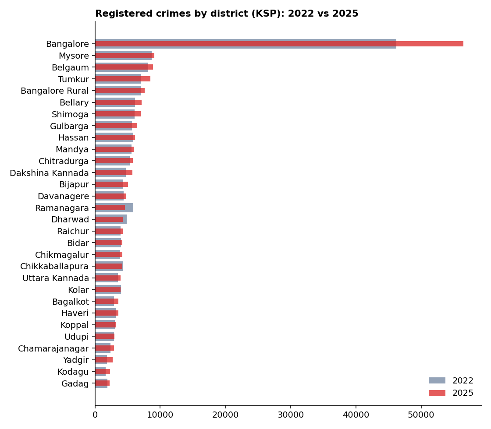
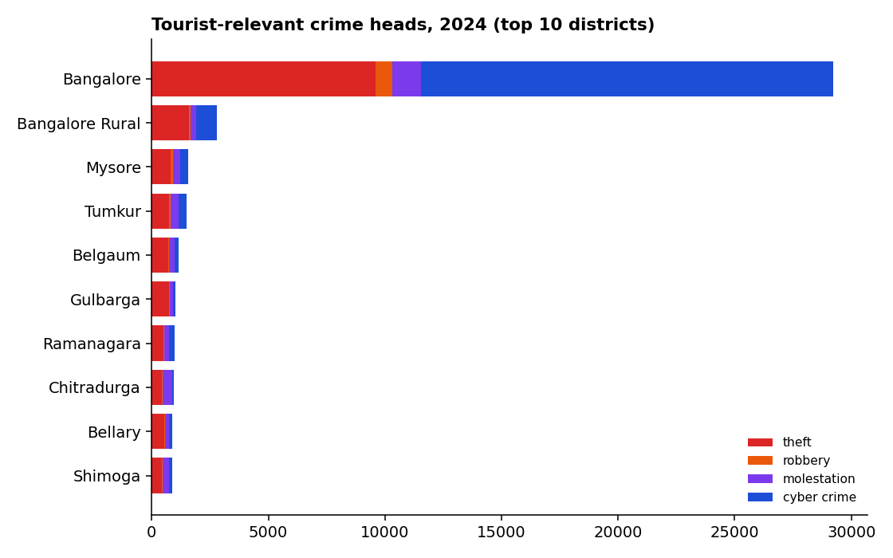
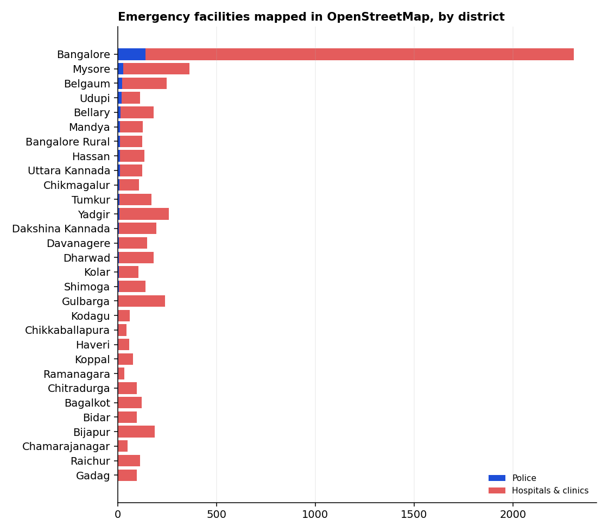
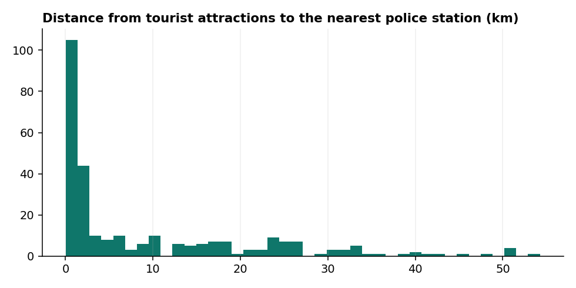
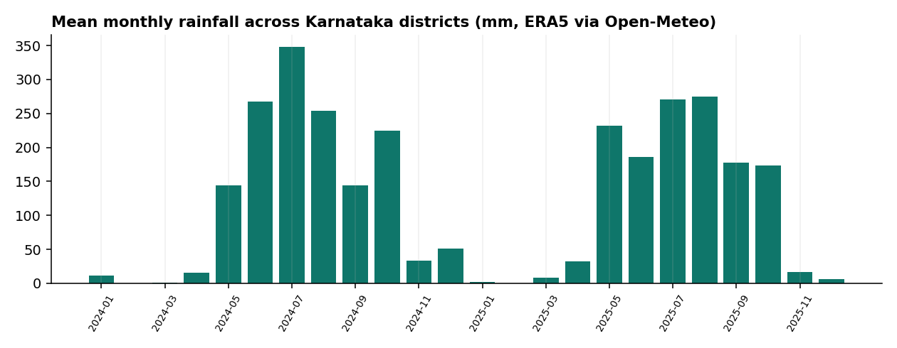
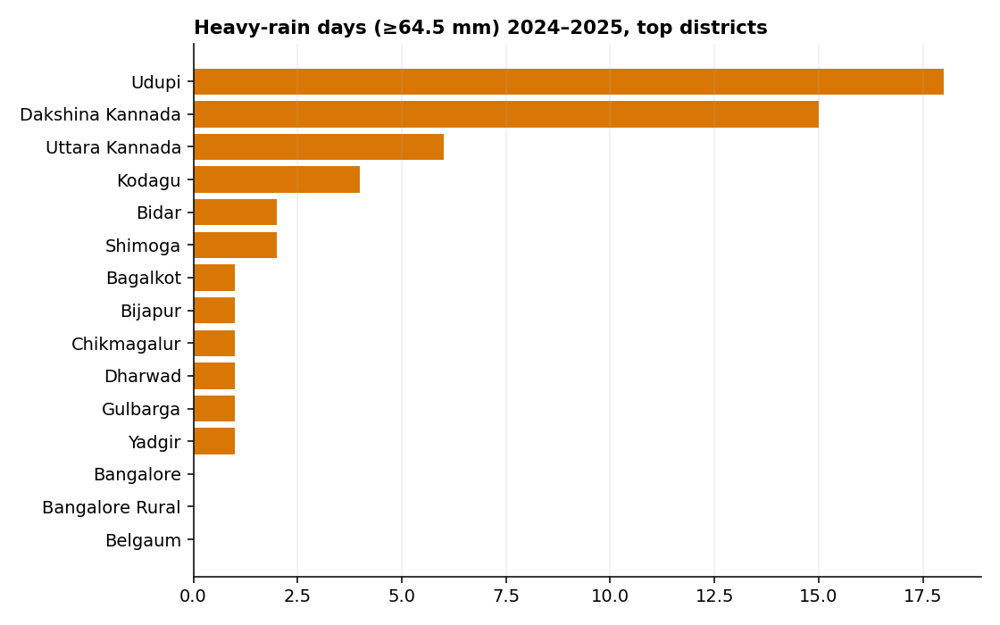
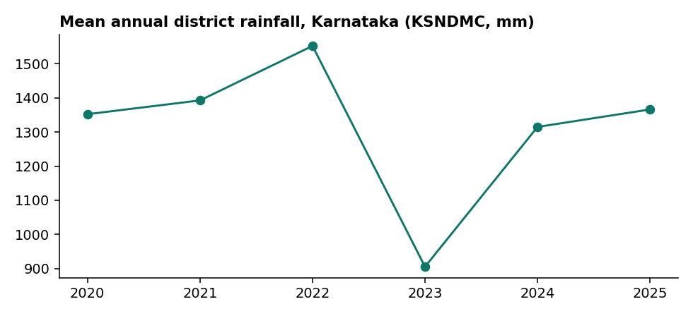

# SafeTrail dataset analysis

Generated 2026-11-02T02:25:40+00:00 by `datasets/scripts/analyze.py` from the files in `datasets/`.

## 1. District-wise crime (Karnataka State Police)

Registered crimes (IPC/BNS + SLL) across the mapped districts: 179,389 in 2022 and 201,733 in 2025 (+12.5%). Bangalore (incl. Bengaluru City commissionerate) records the most: 56,472 in 2025. 2024 head-wise data: 22,115 thefts and 22,397 cyber crimes. Counts are not population-adjusted; IPC was replaced by BNS from July 2024, so 2025 figures combine both codes.

## 2. Emergency facility coverage (OpenStreetMap)

Facilities mapped: {'POLICE': 374, 'HOSPITAL': 3610, 'CLINIC': 2345, 'FIRE_STATION': 63, 'PHARMACY': 1272}. Named tourist attractions: 283.
Median distance from an attraction to the nearest police station: **2.12 km** (90th percentile 26.0 km); to a hospital/clinic: **1.89 km**.
76 attractions are more than 15 km from any mapped police station (see `attractions_far_from_police.csv`).

## 3. Weather hazards (Open-Meteo / ERA5, 2024–2025)

Heavy rain uses the IMD threshold of 64.5 mm/day; heat ≥ 40 °C; gusts ≥ 60 km/h. Per-district counts in `weather_hazard_days_by_district.csv`.

### Official rainfall (KSNDMC)

Mean annual district rainfall by year (mm): {2020: 1352.3, 2021: 1392.6, 2022: 1552.2, 2023: 905.3, 2024: 1314.9, 2025: 1366.1}. Districts ≥20 % above normal in 2025: Bijapur (+47%), Gulbarga (+39%), Yadgir (+33%), Hassan (+30%), Belgaum (+26%), Kolar (+26%), Bagalkot (+25%), Dakshina Kannada (+23%), Raichur (+22%), Bidar (+21%), Udupi (+20%).

## 4. Explainable district risk index

Weighted mean of percentile-ranked components: registered crimes 55 %, heavy-rain days 30 %, heat days 15 %. OSM police density is reported separately as a mapping-coverage gap and is not a risk input. Missing components are dropped and weights renormalised.

| District | Index | Level | Crime total | Heavy-rain days | Police stations |
|---|---|---|---|---|---|
| Dakshina Kannada | 76.8 | HIGH | 5716.0 | 15 | 7 |
| Gulbarga | 76.6 | HIGH | 6448.0 | 1 | 5 |
| Shimoga | 71.6 | HIGH | 6995.0 | 2 | 7 |
| Belgaum | 70.1 | HIGH | 8901.0 | 0 | 22 |
| Bangalore | 66.4 | MEDIUM | 56472.0 | 0 | 142 |
| Bellary | 65.9 | MEDIUM | 7133.0 | 0 | 16 |
| Bijapur | 65.9 | MEDIUM | 5054.0 | 1 | 2 |
| Mysore | 64.5 | MEDIUM | 9128.0 | 0 | 28 |
| Tumkur | 60.7 | MEDIUM | 8470.0 | 0 | 8 |
| Bidar | 59.7 | MEDIUM | 4226.0 | 2 | 2 |
| Bangalore Rural | 58.8 | MEDIUM | 7620.0 | 0 | 12 |
| Dharwad | 56.8 | MEDIUM | 4289.0 | 1 | 7 |
| Uttara Kannada | 55.9 | MEDIUM | 3930.0 | 6 | 11 |
| Chitradurga | 54.9 | MEDIUM | 5838.0 | 0 | 3 |
| Hassan | 51.2 | MEDIUM | 6147.0 | 0 | 11 |

## 5. Machine learning

Not trained: no labelled incident outcomes or incident coordinates are available; district crime data is aggregated counts. Rule-based, explainable scoring is used instead.

## 6. Limitations

- OSM facility coverage is community-mapped and uneven; low counts can mean missing data, not missing facilities.
- ERA5 reanalysis at one centroid per district smooths local extremes; it is not station data.
- Police units are mapped to 2021 district polygons; Vijayanagara is merged into Ballari and Bengaluru South into Ramanagara; Railways is excluded.
- District risk index uses raw crime counts (no population denominator available in the downloaded data), so populous districts rank higher.
- No geocoded crime incidents exist in the open data, so incident hotspot maps cannot be produced from it; hotspots are computed only from SafeTrail's own SOS records in the app.
